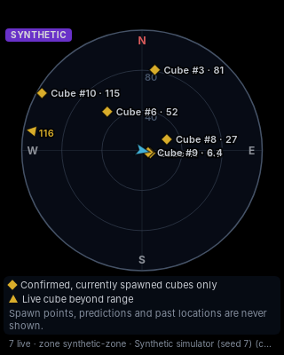
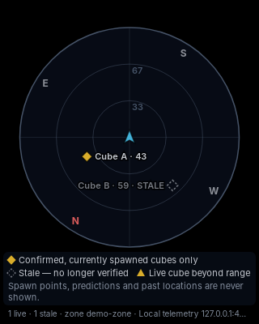

# AION 2 Cube Radar

A Windows 11 desktop overlay that draws a transparent, always-on-top radar of
cubes that a validated data source confirms are **spawned right now**. It
draws nothing else.

Built with Rust (core logic), Tauri 2 (desktop shell), and TypeScript with
HTML Canvas (rendering).

<p>
  
  
</p>

*Left: the built-in simulator. Right: the loopback telemetry demo in
heading-up mode, with a stale cube shown as hollow. Captured on Linux under
Xvfb with no compositor, so the transparent area renders black; on Windows it
is see-through.*

> [!IMPORTANT]
> **It does not read AION 2 data yet.** Research showed that the AION 2 DPS
> meter this project started from has no cube or position data and no API,
> and no other validated source exists ([details](docs/01-dps-meter-research.md),
> [what is missing](docs/03-data-availability.md)). The radar ships with a
> synthetic simulator (always labelled **SYNTHETIC**) and accepts a
> [documented event protocol](docs/radar-event-protocol.md) from any
> authorized tool. It contains no guessed AION 2 packet formats.

## What it guarantees

The legend on the radar says it: **markers are confirmed, currently spawned
cubes only.**

| Situation | Result |
|---|---|
| Confirmed spawn (`cube_spawned`, live, with id and position) | One marker |
| Confirmed despawn or collection | Marker removed |
| Static spawn point | Never shown |
| Historical or predicted location | Never shown |
| The same spawn sent twice | Still one marker |
| `seen` without a spawn, no id, no position | Never shown (`UNKNOWN` / rejected) |
| No confirmation within the stale timeout | `STALE`: hidden, or drawn hollow and labelled STALE if you choose |
| Late event older than a removal | Rejected; the cube stays removed |
| Zone change | Every cube dropped |
| Backend stops sending frames | Markers cleared, "No data" banner |

Every rejected event is counted and listed in the **Diagnostics** panel of
the settings window. That history is for debugging only and is never drawn on
the radar.

## Features

* Transparent, borderless, resizable, always-on-top overlay that doesn't
  steal focus from the game. Optional **click-through**.
* **Separate-window mode**: a normal framed window that does not stay on top.
* Player marker with heading. Cube markers with labels and distances.
  **Rim arrows** for live cubes beyond range.
* North-up or heading-up, extra rotation, range (scale), opacity, all colours.
* Configurable **stale timeout**, and whether stale cubes are hidden or marked.
* Rendering at display refresh rate, with the player interpolated between
  20 Hz frames. Ingestion runs on its own threads and never blocks the UI.
* Data sources: synthetic simulator, replay of `.jsonl` / `.srf` files, and a
  loopback-only TCP socket for an authorized telemetry producer.
* A coordinate-frame mapping (axes, scale, origin, heading convention) for
  any source.
* Logs to the console and to the app log directory.

## Safety and terms of service

This project **does not** inject code, read or write game memory, capture or
modify network traffic, bypass anti-cheat, or automate input. It reads only
what a data source hands it over `127.0.0.1` or from a file.

That is not a statement about AION 2's terms of service. Whether *any* overlay
or data source is allowed is NCSoft's call. Check before connecting a real
source.

## Quick start (development)

Requirements: Rust (stable, MSVC toolchain on Windows), Node 18+ and pnpm,
and on Windows the WebView2 runtime (preinstalled on Windows 11).

```sh
pnpm install
pnpm tauri dev           # run the app (radar + settings window on first start)
```

To try local telemetry, set Settings → Data source → *Local telemetry on
127.0.0.1* (port 47810), apply, then run:

```sh
python tools/telemetry_demo.py
```

To look at the UI in a browser without building the app, run `pnpm dev`. It
renders fabricated preview frames and says so (**PREVIEW** badge); the Rust
pipeline does not run in this mode.

## Tests

```sh
cargo test                       # radar-core + radar-ingest (no WebView needed)
cargo test --workspace           # also the Tauri crate (needs WebKitGTK on Linux)
pnpm test                        # projection and layout (vitest)
pnpm typecheck
cargo clippy --workspace --all-targets -- -D warnings
```

What is covered:

* The **six acceptance tests** of requirement 7, by name, in
  `crates/radar-core/src/tracker/tests.rs` (`acceptance_1_…` to
  `acceptance_6_…`).
* The same scenario as a readable fixture with checkpoints:
  `crates/radar-ingest/fixtures/acceptance.jsonl`, run by
  `crates/radar-ingest/tests/acceptance.rs`.
* A property test: five simulated minutes with duplicates, spawn points and
  historical locations mixed in. At every step the radar's markers must
  exactly equal the simulator's ground truth.
* Synthetic byte-stream parsing under every chunk size, garbage, resync, bad
  lengths and unknown opcodes.
* Coordinate transforms, bearings, screen projection (north-up and
  heading-up), rim clamping, settings sanitising, settings-file recovery,
  loopback TCP and replay timing.

## Building the Windows installer

On Windows 10/11 with the prerequisites above:

```powershell
pnpm install
pnpm tauri build
```

Output:

* `target\release\bundle\nsis\AION 2 Cube Radar_0.1.0_x64-setup.exe`:
  per-user installer, no admin rights needed. It downloads the WebView2
  runtime if it is missing.
* `target\release\bundle\msi\AION 2 Cube Radar_0.1.0_x64_en-US.msi`

CI builds both on every push to `main` and on tags; see
`.github/workflows/ci.yml`. The installers are not code-signed, so Windows
SmartScreen will warn on first run.

Settings live in `%APPDATA%\dev.aion2radar.overlay\settings.json`, and logs
in `%LOCALAPPDATA%\dev.aion2radar.overlay\logs\radar.log`. An invalid settings
file is kept as `settings.json.bak` and replaced with defaults.

## Connecting an authorized data source

Write a producer that speaks the
[Radar Event Protocol v1](docs/radar-event-protocol.md): JSON lines over
`127.0.0.1:47810`, or a `.jsonl` file to replay. `tools/telemetry_demo.py` is
a complete example. Before trusting a source, go through the checklist in
[docs/03-data-availability.md](docs/03-data-availability.md#what-it-would-take-to-support-a-real-source):
authorization, real spawn/despawn evidence, stable ids, periodic `cube_seen`,
a known coordinate frame, and a validation run.

## Project layout

```
crates/radar-core/      event model, live-cube tracker, geometry, settings (pure Rust, no I/O)
crates/radar-ingest/    sources, protocol, adapter, synthetic SRF parser, simulator, pipeline
  fixtures/             acceptance.jsonl, malformed.jsonl, synthetic-session.srf.hex
  tests/acceptance.rs   end-to-end acceptance tests
src-tauri/              Tauri shell: windows, commands, settings file, logging
src/                    TypeScript: radar.ts, settings.ts, lib/{projection,layout,renderer,bridge}.ts
tools/telemetry_demo.py reference protocol producer (synthetic data)
docs/                   research, architecture, protocol, data availability
```

## Development stages

| Stage | Status |
|---|---|
| 1. Inspect the DPS meter's architecture and license | Done: [docs/01-dps-meter-research.md](docs/01-dps-meter-research.md) |
| 2. Working radar with synthetic cubes | Done |
| 3. Coordinate transformations and unit tests | Done |
| 4. Validated, authorized telemetry adapter | Adapter and protocol done; **no validated AION 2 source exists** |
| 5. Verify game versions, document missing data | Done: [docs/03-data-availability.md](docs/03-data-availability.md) |
| 6. Windows installer and build instructions | Config, CI job and instructions done. Not built on Windows in this environment |
| 7. Live cube tracking, spawned cubes only | Done, with acceptance tests |

## License

MIT; see [LICENSE](LICENSE). No code from the GPL-3.0 Aether DPS meter is
included; it was studied as an architectural reference only.
