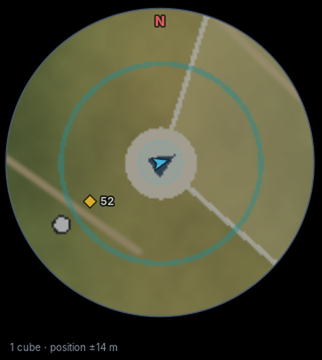
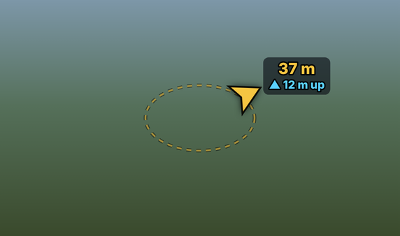
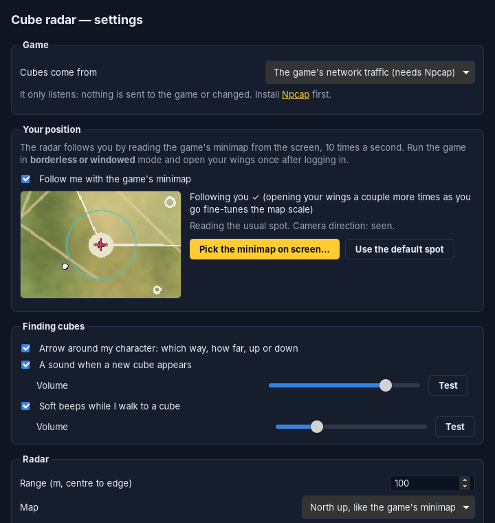

# AION 2 Cube Radar

A Windows 11 desktop overlay that draws a transparent, always-on-top radar of
cubes that a validated data source confirms are **spawned right now**. It
draws nothing else.

Built with Rust (core logic), Tauri 2 (desktop shell), and TypeScript with
HTML Canvas (rendering).

<p>
  
  
</p>

*Left: the radar following the player on the minimap alone, 50 s after the
only position report (end-to-end test with a made-up minimap; in game it shows
the game's own). Right: the arrow drawn around your character over the game.*

What's new: [CHANGELOG.md](CHANGELOG.md).

> [!IMPORTANT]
> **Live hidden cubes from the game: Verteron and Altgard.**
> With *Packet capture* (Npcap) the radar reads the game's own traffic
> passively and shows hidden cubes the server reports around you, roughly
> within **100 m** (the server sends nothing farther away). The packet
> layouts come from the
> [aion2-cube-radar](https://github.com/dennisreichenberg/aion2-cube-radar)
> findings, re-implemented here and checked against its real captures. The
> Altgard cube type was confirmed in game by a user of this radar. Cube types
> in other zones are learned the first time you open one with a key.
> Details, evidence and limits: [docs/05-aion2-protocol.md](docs/05-aion2-protocol.md).
>
> The server reports your own position only with events (opening your
> wings, buffs). In between, the radar **follows you by reading the game's
> minimap from the screen** (like a screenshot) and measuring how far it
> scrolls; the server reports set where you are and the minimap's scale.
> Verified for the global client build 25800038; a patch can move opcodes
> (fixable in a JSON file).

## What it guarantees

The legend on the radar says it: **markers are confirmed, currently spawned
cubes only.**

| Situation | Result |
|---|---|
| Confirmed spawn (`cube_spawned`, live, with id and position) | One marker |
| Confirmed despawn or collection | Marker removed |
| Static spawn point | Never shown |
| Historical or predicted location | Never shown |
| The same spawn sent twice | Still one marker |
| `seen` without a spawn, no id, no position | Never shown (`UNKNOWN` / rejected) |
| No confirmation within the stale timeout | `STALE`: hidden, or drawn hollow and labelled STALE if you choose |
| Late event older than a removal | Rejected; the cube stays removed |
| Zone change | Every cube dropped |
| Backend stops sending frames | Markers cleared, "No data" banner |

Every rejected event is counted and listed in the **Diagnostics** panel of
the settings window. That history is for debugging only and is never drawn on
the radar.

## Features

* Transparent, borderless, resizable, always-on-top overlay that doesn't
  steal focus from the game. Optional **click-through**; **Ctrl+Alt+S**
  opens the settings at any time.
* **Separate-window mode**: a normal framed window that does not stay on top.
* Player marker with the camera direction (read from the minimap's view
  cone) or the direction you are moving. Cube markers with labels and
  distances. **Rim arrows** for live cubes beyond range.
* **Minimap tracking**: follows you between server reports by reading the
  in-game minimap from the screen; the live minimap can be drawn behind the
  radar.
* **An arrow around your character** in the game view, to the nearest live
  cube (turning with the camera), saying how far and whether it is **up or
  down**, updated 10 times a second; quiet beeps as you get closer.
* A **map grid fixed to the world** and your **path over the last minute**,
  so the radar moves like a map as you walk. A dashed circle shows how sure
  an estimated position is.
* **Minimap overlay** style: markers only, for placing the window over the
  game's minimap.
* A **sound when a new cube appears**: a built-in chime or any sound file
  you choose, with its own volume.
* North-up or heading-up, extra rotation, range (scale), opacity, all colours.
* Configurable **stale timeout**, and whether stale cubes are hidden or marked.
* Rendering at display refresh rate, with the player interpolated between
  20 Hz frames. Ingestion runs on its own threads and never blocks the UI.
* Data sources: **passive packet capture** of the game's traffic (with a
  decoder profile), synthetic simulator, replay of `.jsonl` / `.srf` /
  `.pcap` / `.pcapng` files, and a loopback-only TCP socket for any telemetry
  producer.
* Discovery tools for finding the cube packet: recording, global marker
  hotkeys (**Ctrl+Alt+V** cube appeared, **Ctrl+Alt+C** collected), a live
  packet-type census, and the `radar-capture` CLI (`analyze`, `inspect`,
  `decode`).
* A coordinate-frame mapping (axes, scale, origin, heading convention) for
  any source.
* Logs to the console and to the app log directory.

## Safety and terms of service

With packet capture on, the radar **copies** your PC's own TCP packets
through Npcap (receive-only, non-promiscuous), like the Aether DPS meter. It
**never** sends, blocks or modifies packets, injects code, opens or reads the
game's process or memory, bypasses anti-cheat, or automates input. Recordings
contain only the game connection.

Minimap tracking copies one small rectangle of the screen (the minimap), the
way screenshot and streaming tools do (GDI). It does not open the game's
window or process. While it runs, the radar and the guide arrow exclude
themselves from screen captures, so they also do not show in your own
recordings or screenshots.

None of that is a promise about AION 2's terms of service. Another tool's
author reports that NCSoft support called traffic-reading software a ToS
violation. Using this, especially to locate collectibles, **can get your
account banned**. You use it at your own risk.

## Quick start (development)

Requirements: Rust (stable, MSVC toolchain on Windows), Node 18+ and pnpm,
and on Windows the WebView2 runtime (preinstalled on Windows 11).

```sh
pnpm install
pnpm tauri dev           # run the app (radar + settings window on first start)
```

To try local telemetry, set Settings → *Game* → *Cubes come from* →
**Another program on this PC** (port 47810), then run:

```sh
python tools/telemetry_demo.py
```

To look at the UI in a browser without building the app, run `pnpm dev`. It
renders fabricated preview frames and says so (**PREVIEW** badge); the Rust
pipeline does not run in this mode.

## Tests

```sh
cargo test                       # radar-core + radar-ingest (no WebView needed)
cargo test --workspace           # also the Tauri crate (needs WebKitGTK on Linux)
pnpm test                        # projection and layout (vitest)
pnpm typecheck
cargo clippy --workspace --all-targets -- -D warnings
```

What is covered:

* The **six acceptance tests** of requirement 7, by name, in
  `crates/radar-core/src/tracker/tests.rs` (`acceptance_1_…` to
  `acceptance_6_…`).
* The same scenario as a readable fixture with checkpoints:
  `crates/radar-ingest/fixtures/acceptance.jsonl`, run by
  `crates/radar-ingest/tests/acceptance.rs`.
* A property test: five simulated minutes with duplicates, spawn points and
  historical locations mixed in. At every step the radar's markers must
  exactly equal the simulator's ground truth.
* Synthetic byte-stream parsing under every chunk size, garbage, resync, bad
  lengths and unknown opcodes.
* Coordinate transforms, bearings, screen projection (north-up and
  heading-up), rim clamping, settings sanitising, settings-file recovery,
  loopback TCP and replay timing.
* Capture: link-layer/IP/TCP parsing, pcap and pcapng files, TCP reassembly
  (reordering, retransmits, wrap-around, gaps), the documented AION 2 framing
  (varint lengths, flag byte, padding, nested LZ4 bundles, heartbeat resync,
  any chunking), game-stream detection and zone changes, census,
  marker correlation, field inspection and decoder profiles. End to end, the
  synthetic session's markers point at its spawn packet, and decoding it puts
  exactly the live cubes on the radar.

## Building the Windows installer

On Windows 10/11 with the prerequisites above:

```powershell
pnpm install
pnpm tauri build
```

Output:

* `target\release\bundle\nsis\AION 2 Cube Radar_0.2.0_x64-setup.exe`:
  per-user installer, no admin rights needed. It downloads the WebView2
  runtime if it is missing.
* `target\release\bundle\msi\AION 2 Cube Radar_0.2.0_x64_en-US.msi`

The NSIS installer's last page has a *Create desktop shortcut* box (ticked by
default). Settings → *Radar* → **Create desktop shortcut** makes one at any
time.

The capture tool: `cargo build --release -p radar-capture` →
`target\release\radar-capture.exe`.

CI builds the installers and `radar-capture.exe` on every push to `main` and
on tags; see `.github/workflows/ci.yml`. The installers are not code-signed, so Windows
SmartScreen will warn on first run.

Settings live in `%APPDATA%\dev.aion2radar.overlay\settings.json`, and logs
in `%LOCALAPPDATA%\dev.aion2radar.overlay\logs\radar.log`. An invalid settings
file is kept as `settings.json.bak` and replaced with defaults.

## Packet capture in short

1. Install [Npcap](https://npcap.com) (default options).
2. Settings → *Game* → *Cubes come from*: **The game's network traffic**.
   Changes apply by themselves. (Adapter and decoder are under *More
   settings → Game traffic*; the defaults — all adapters, the built-in AION 2
   decoder — are right.)
3. Log in and **open your wings once**. The capture panel should show a
   *Game connection*, your zone and your character.
4. Hidden cubes within about 100 m appear on the radar, with a sound. They
   disappear when someone opens them and turn stale when you walk out of range.
5. Walk around. With minimap tracking (on by default) the radar follows you
   between server reports; open your wings once more after moving 10 m or
   so, and the minimap's scale is confirmed (see *Your position* below).
6. If the radar looks mirrored compared with the minimap, switch *Map north*
   to +Y (*More settings → Game traffic*).



### Your position

The server sends your position only when something happens to you: opening
your wings, a buff, being attacked, a loading screen. Between those, the
radar uses, best first:

1. **The in-game minimap.** It is north-up and centred on you, so it scrolls
   as you move. The radar reads it from the screen about 10 times a second
   and measures the scroll; each server report sets where you are, and the
   distance between two reports teaches it the minimap's scale. The view
   cone on the minimap gives the camera direction.
   * Run the game in **borderless or windowed** mode (exclusive fullscreen
     shows up black).
   * The minimap's default spot is found automatically. If you moved or
     resized it (Edit HUD), use Settings → *Your position* → **Pick the
     minimap on screen…**; the preview there shows what is being read.
   * The status line says what it is doing, for example "Open your wings
     once so the radar knows where you are" or "Following you ✓".
2. **An estimate from objects around you**, when the minimap is hidden or
   unclear. The server adds objects as they come within a fixed distance of
   you and removes them as they fall behind; each says "you are about R from
   here". R is learned per object type, from the minimap and the server
   reports.

The game encrypts what your client sends, so your own movement packets
cannot be read (that would need the game's memory, which this app never
touches). What is learned (minimap scale, object distances) is saved to
`aion2-learned.json` in the settings folder and used next time. Details:
[docs/06-minimap-tracking.md](docs/06-minimap-tracking.md).

### Guide arrows

Settings → *Finding cubes*. Over the game, a ring around your character
with an arrow to the nearest live cube, turned with the camera so that
"ahead" is where you look, and a label: how far, and whether the cube is
**up or down** (▲ 12 m up, ▼ 5 m down, same height). Within a few metres
the arrow gives way to "right here" and where to look (▲ look up · 8 m).
The radar itself stays clean: the map, you, and the cubes with their
distances. If the ring is not around your character, adjust it under
*More settings → Arrow over the game*.

* **Up or down, 10 times a second.** The server sends each cube's exact
  height, and yours with every event (wings, buffs, loading screens). In
  between, your height comes from the ground around you: the server keeps
  sending where monsters, NPCs, gathering spots and other players stand,
  so the app fits the ground under you from them at every minimap reading,
  and checks that fit against each of your own reported positions. When
  the ground around you is unclear (cliffs, bridges, nothing nearby) or you
  are flying, it falls back to the last reported height and is careful:
  up or down is only said when it is clearly so ("~" when roughly), and
  near a cube it otherwise says *up or down? open your wings once*.
* **Beeps** (on, quiet): soft beeps from 30 m while you walk to the cube, a
  little faster as you get closer, and a short chime when you arrive. They
  stop a few seconds after you stop going for it. Own volume and *Test*.

Why not a circle on the cube itself in the game picture? That would need
the camera's tilt and zoom, which only exist in the game's memory, and this
app never reads it. A circle guessed from the screen alone would often sit
in the wrong place.

### Cube sound

Settings → *Finding cubes*: the new-cube sound on/off, its volume and
*Test*. The built-in sound is a chime made by the app. No sound from any game
is included, but if you have a sound file you like, such as a loot-filter
drop sound, put its full path under *More settings → New-cube sound*.

For zones or patches the built-in decoder doesn't know yet, the discovery
tools are still there: recording, marker hotkeys (**Ctrl+Alt+V** cube
appeared, **Ctrl+Alt+C** collected) and `radar-capture analyze` / `inspect`.
See [docs/04-packet-capture.md](docs/04-packet-capture.md).

## Connecting another data source

Write a producer that speaks the
[Radar Event Protocol v1](docs/radar-event-protocol.md): JSON lines over
`127.0.0.1:47810`, or a `.jsonl` file to replay. `tools/telemetry_demo.py` is
a complete example. Before trusting a source, go through the checklist in
[docs/03-data-availability.md](docs/03-data-availability.md#what-it-would-take-to-support-a-real-source):
authorization, real spawn/despawn evidence, stable ids, periodic `cube_seen`,
a known coordinate frame, and a validation run.

## Project layout

```
crates/radar-core/      event model, live-cube tracker, geometry, settings (pure Rust, no I/O)
crates/radar-ingest/    sources, protocol, adapter, synthetic SRF parser, simulator, pipeline
crates/radar-capture/   Npcap/libpcap capture, TCP reassembly, AION 2 framing, census,
                        discovery, decoder profiles, capture source; `radar-capture` CLI
crates/radar-vision/    minimap tracking: screen capture (Windows GDI), map movement,
                        camera direction
  fixtures/             acceptance.jsonl, malformed.jsonl, synthetic-session.srf.hex
  tests/acceptance.rs   end-to-end acceptance tests
src-tauri/              Tauri shell: windows, commands, settings file, logging
src/                    TypeScript: radar.ts, settings.ts, guide.ts, minimapSetup.ts,
                        lib/{projection,layout,renderer,bridge,guide,mapgrid,sound}.ts
tools/telemetry_demo.py reference protocol producer (synthetic data)
docs/                   research, architecture, protocol, data availability
```

## Development stages

| Stage | Status |
|---|---|
| 1. Inspect the DPS meter's architecture and license | Done: [docs/01-dps-meter-research.md](docs/01-dps-meter-research.md) |
| 2. Working radar with synthetic cubes | Done |
| 3. Coordinate transformations and unit tests | Done |
| 4. Validated telemetry adapter | Done: passive capture with a built-in AION 2 cube decoder, checked against real captures from aion2-cube-radar ([evidence](docs/05-aion2-protocol.md)); used live in Verteron and Altgard by a user |
| 5. Verify game versions, document missing data | Done: [docs/03-data-availability.md](docs/03-data-availability.md) |
| 6. Windows installer and build instructions | Config, CI job and instructions done. Not built on Windows in this environment |
| 7. Live cube tracking, spawned cubes only | Done, with acceptance tests |

## License

MIT; see [LICENSE](LICENSE). No code from the GPL-3.0 Aether DPS meter is
included; it was studied as an architectural reference only.
