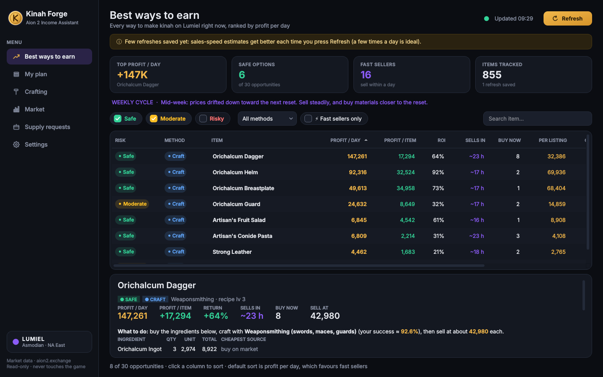
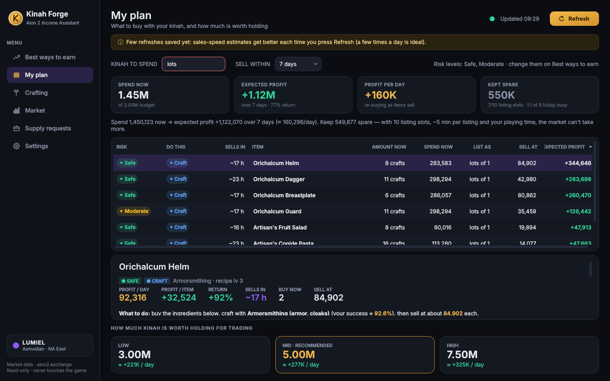
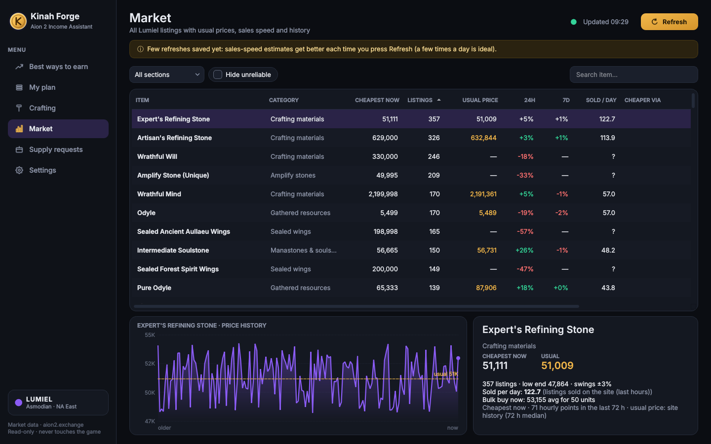
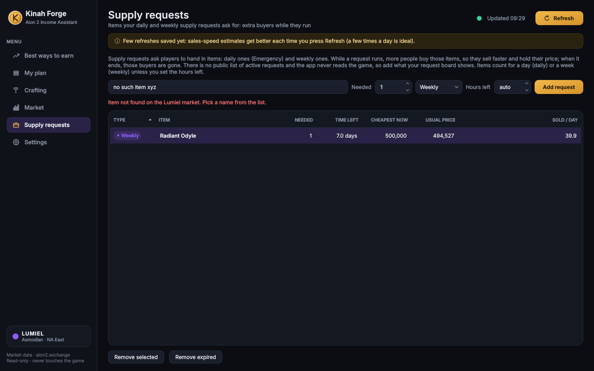
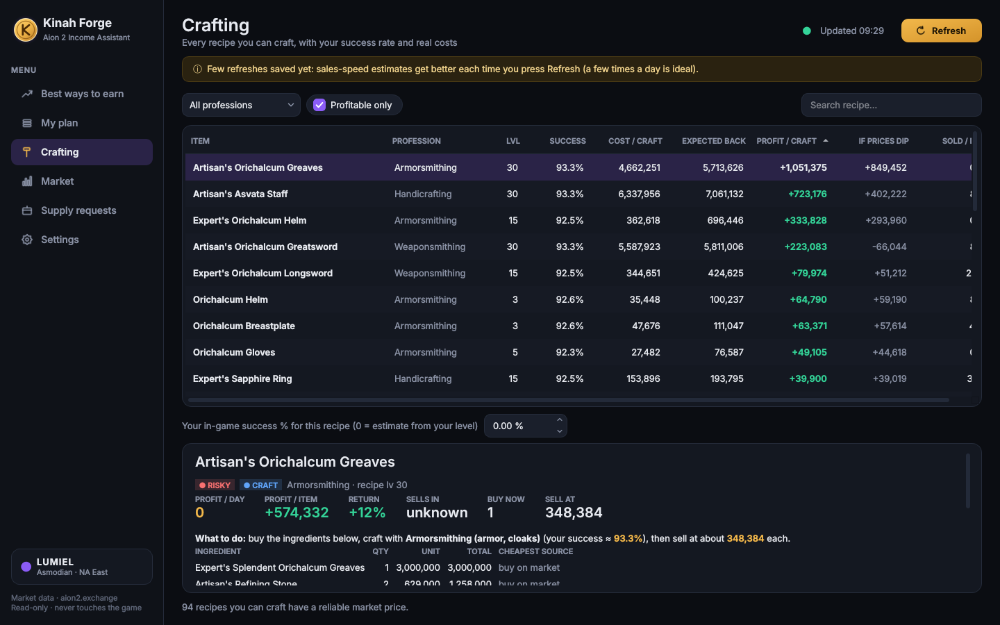
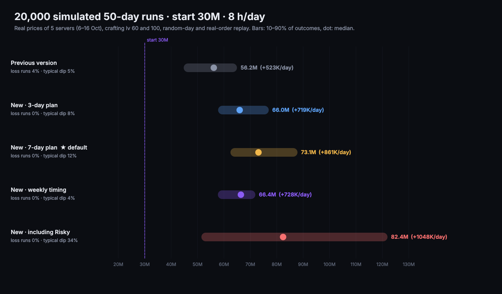

# Aion 2 Income Assistant (Lumiel)

A Windows 11 desktop app that reads the **Lumiel** market from
[aion2.exchange](https://aion2.exchange) and tells you what makes the most kinah:
which recipes to craft, which underpriced listings to buy and resell, how much
to buy, how fast it sells, and how risky it is.



<p>
  
  
  
  
</p>

*Screenshots use test data from another Asmodian server, not live Lumiel prices.*

It only reads a public website. It never touches the game, its files, its
memory or its network traffic.

## Get it

* **Ready-made .exe**: the *Income Assistant* GitHub Actions workflow builds
  `Aion2IncomeAssistant.exe` on Windows (tests run first). Download it from the
  run's *Artifacts* section and double-click it. Nothing to install.
* **From source**: install Python 3.12 from python.org, then double-click
  `run.bat` (it sets everything up the first time). `build_exe.bat` builds the
  .exe yourself.

## Using it

1. Open **Settings** and enter your crafting levels (0 = you don't have that
   profession). Check the market fees (default: 10% sales tax + 2% listing fee).
2. Press **Refresh**. Every press downloads the latest Lumiel prices. The
   first one takes about 40 seconds because it loads price history for the
   important items. Later ones take a few seconds.
3. **Best ways to earn** lists every opportunity, sorted by **profit per day**.
   Tick *Safe / Moderate / Risky* to filter, or *Fast sellers only*. Click a
   row for step-by-step instructions: ingredients, where to get each one
   cheapest, what to list at, how many to buy.
4. **My plan**: type how much kinah you can spend (`5m`, `500k`, …) and how
   soon you want it sold. You get what to buy or craft, how much to spend
   and the expected profit. Below that are three suggested amounts worth
   holding for trading (Low ≤ 5M, Mid ≤ 15M, High ≤ 30M), based on how much
   the market can actually absorb.
5. **Crafting** shows every recipe you can make, with the estimated success
   rate. If the game's probability tab shows a different number, type it in
   and every result updates.
6. **Market** lists all items, with a price chart, usual price, sales speed and
   warnings.

Refresh a few times a day. Every refresh is saved, so the app builds its own
price and sales history, and its estimates get better over time.

## Supply requests

Daily (Emergency) and weekly supply requests make players buy the items they ask
for. There's no public feed of which requests are up, and the app never reads the
game, so add them on the **Supply requests** page (item, amount, daily/weekly,
optional hours left). While a request runs, the app counts about 30% extra buyers
for that item (an assumption: there's no data to measure it yet) and doesn't apply
the market's downward drift to it. It warns you when less than a day is left,
because those buyers disappear when the request ends.

## Market limits it plans around

* At most **10 listings** can be up at once, and putting one up takes about
  **5 minutes**, so your playing time (Settings → hours per day) caps how much
  you can sell. Gear is listed one per listing. Stackables go in small lots,
  because buyers take whole listings and prefer small ones. The plan uses at most
  10 items and never more listing time than you have.
* **It learns from history how prices behave a day later.** Every refresh adds
  to that history. It measures how much of a dip (cheapest listing 10%+ below its
  usual price) has recovered 24 hours later, and how prices drift overall. A
  resale only counts the share of the dip that really recovers, and a falling
  price is expected to keep falling. Without enough history it assumes only 30%
  of a dip recovers.

## What 20,000 simulations taught it

`tools/simulate.py` follows the app's plan every day: real prices replayed (in random
day order and in real order), craft success and Splendent combos rolled, buyers
arriving at random, 10 listing slots, 5 minutes per listing, leftovers carried over.
It was run on the real price history of five servers (Siel, Nezekan, Kaisinel,
Israphel, Zikel; 6–16 Oct 2026). Kaisinel publishes real sales; the others borrow
Kaisinel's sales volumes.



**First: 50 setups (5 servers × 10 strategies), ~40,000 logged trades.**

* Predicted returns were about 2.5× too high, but in the right order. Trades predicted
  under 10% lost money; trades predicted 50% made about 30%. The app now shows a
  **realistic** return (`0.95·ln(1+predicted) − 0.07`), fitted on four servers and
  checked on the fifth.
* Only two warnings really predicted losses: *loses money if the price falls to its
  recent low* and *only profitable when the Splendent combo hits*. Those, and thin
  margins, are now **Risky**. Big price swings alone no longer are; those trades
  still paid.
* Buying cheap listings to resell rarely worked: on this data, dips seldom
  recovered within a day.

**Then: rules picked on four servers and tested on the fifth.**

* Ranking by realistic profit and **putting at most 15% of the budget into one
  item** removed nearly all losing runs.
* **Holding several days of stock** was the biggest gain: good chances don't come
  every day, but you can sell every day. That held in real-day order too, with
  prices falling ~3%/day. The default plan is now **7 days, with up to 5 days of
  stock**.

**Finally: 20,000 runs starting with 30M, 8 h/day.**

| Plan | Median after 50 days | 10–90% of runs | Runs below 30M |
|---|---|---|---|
| Previous version | 56M (+0.52M/day) | 45–65M | 4% |
| New, 3-day plan | 66M (+0.72M/day) | 58–77M | 0% |
| **New, 7-day plan (default)** | **73M (+0.86M/day)** | **62–88M** | **0%** |
| New + Risky | 82M (+1.05M/day) | 52–122M | 0%, but dips of ~34% |

The app's realistic return was close to what trades really made, within about 15
percentage points in each band. The volume engine is crafting materials (wood,
leather, paper, powder); the best returns came from crafted armour.

**Be careful with these numbers.** On Kaisinel, the one server with its own real
sales data, the 7-day plan made only about +10M on 30M. On the other servers, where
sales volumes are borrowed, it made +35–60M. Lumiel will probably land in between.
The game is new and prices are hard to predict, so refresh often: the app keeps
re-learning from your own history.

**Weekly supply-request cycle.** On all five servers, crafted items had their biggest
share of market activity the day after the weekly reset (Wednesday). Crafted items
were cheapest just before it, and materials rose ~20% right after it. The app shows
this as a weekly tip on the first page. Timing purchases around it gave smoother
results in the simulation, but not more profit. With one week of data it's a hint,
not a rule.

Once you've refreshed for a week or two, run it on your own Lumiel history:
`python tools/simulate.py "%APPDATA%\\Aion2IncomeAssistant\\history.db" --start 30m`

## How the numbers are made

| Topic | Rule |
|---|---|
| Usual price | Median of the last 72 hours of hourly prices. One bait listing can't move it. |
| What you can sell at | Never above the usual price, never above the cheapest competing listing. |
| Low stock / not selling | Items with fewer than 3 listings, or listed for 12+ hours without selling, are never used as proof of a profit. Spiked listings (far above usual) are ignored. |
| Sales speed | Real sales counts when the site publishes them; otherwise listings that disappear between 10-minute snapshots and between your refreshes (×0.7, because some are cancellations). |
| Your share | As one more seller you're assumed to win 30% of an item's daily sales. A suggested batch is about one day of that. |
| Fast vs. big margin | Ranked by profit per day. In the plan, money from fast sellers is re-spent as it comes back, so a 5% item that sells in hours can beat a 30% item that takes a week. |
| Market tax | 10% sales tax + 2% listing fee by default (most guides agree; one says 8%). Change it in Settings. |
| Substance Morph | Each Odyle grade morphs 1:1 into ore, gems, logs and plants of the same grade (the results can't be sold). An ingredient uses the Odyle price only when that's cheaper than buying the material. |
| Other substitutions | Crafting intermediates yourself (ore → ingot → gear) when cheaper, alternative ingredients a recipe accepts, NPC-shop supplies, and bulk prices for big quantities (the cheapest listing runs out). |
| Crafting success | Estimated from your proficiency minus the recipe level, using community measurements of the game's probability tab (e.g. Superior Healing Potion 72.88% at +0 → 90.89% at +60; Dragon Lord gear 67.5% → 94.6%). Failed crafts lose the materials. A success has the recipe's combo chance (usually 25%) of rolling for the Splendent version. |
| Risk: Safe | Real sales evidence, stable prices, still profitable if prices drop to their recent low, sells within ~3 days, and for crafts a success rate of 85%+. |
| Risk: Risky | No sales evidence, big price swings, slow selling, falling price, an ingredient with almost no listings, or profit that only exists if the Splendent combo hits. |

## Data sources

* Market data: the public aion2.exchange API (`/api/servers`, `/api/items`,
  `/api/items/{id}/prices`, `/api/items/{id}/depth`). Lumiel is server 12104
  (NA East, Asmodian), looked up by name on each refresh.
* Recipes: the gamers4.life crafting database (a copy ships with the app, and
  it re-downloads weekly to pick up patches).
* NPC shop prices: community guides. The ones marked *estimated* in
  `aion_income/data/npc_prices.json` couldn't be confirmed; the app tells you
  when a recipe uses one.

## Development

```
pip install -r requirements-dev.txt
QT_QPA_PLATFORM=offscreen python -m pytest -q tests
```

The tests run against a local stand-in for aion2.exchange that serves real
market rows (`tests/fixtures`) in the API's exact format.
