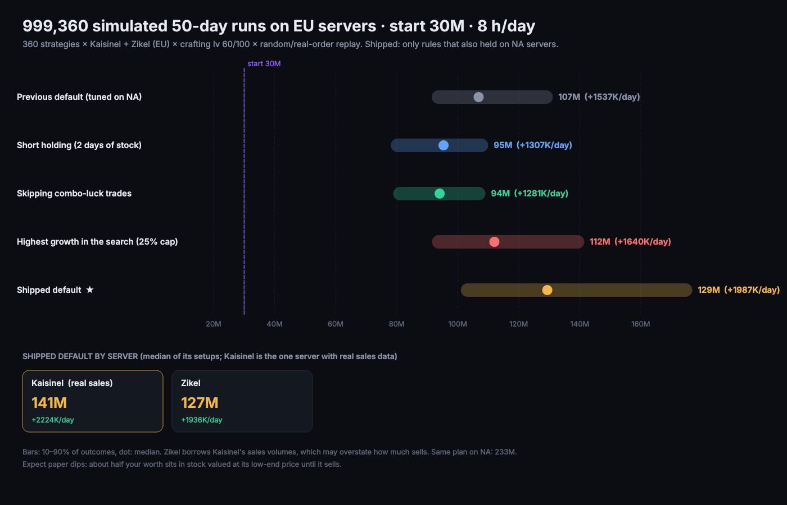

# Aion 2 Income Assistant (Lumiel, EU)

A Windows 11 desktop app that reads the **Lumiel (Europe)** market from
[aion2.exchange](https://aion2.exchange) and tells you what makes the most kinah:
which recipes to craft, which underpriced listings to buy and resell, how much
to buy, how fast it sells, and how risky it is.


<p>
  
  
  
  
</p>

*Screenshots use test data from another Asmodian server, not live Lumiel prices.*

It only reads a public website. It never touches the game, its files, its
memory or its network traffic.

## Get it

* **Public download link:** once a release is published (see below), anyone can
  download the app from
  [Aion2IncomeAssistant.exe](https://github.com/SP4CEGLID3R/aion/releases/latest/download/Aion2IncomeAssistant.exe)
  without a GitHub account. Double-click it; nothing to install. Windows may warn
  that the app isn't code-signed: click **More info → Run anyway**.
* **Publishing a release:** on GitHub open *Releases → Draft a new release*, type a
  new tag like `income-v1.0.0` (target: this branch), and publish. The *Income
  Assistant* workflow then runs the tests on Windows, builds the .exe and attaches
  it to that release automatically.
* **Latest build without a release:** the *Income Assistant* workflow run's
  *Artifacts* (needs a GitHub login; expires after 90 days).
* **From source:** install Python 3.12 from python.org, then double-click
  `run.bat` (it sets everything up the first time). `build_exe.bat` builds the
  .exe yourself.

## Using it

1. Open **Settings** and enter your crafting levels (0 = you don't have that
   profession). Check the market fees (default: 10% sales tax + 2% listing fee).
   The server is **Lumiel, region EU** by default. Several regions have a Lumiel,
   so if you ever play on another one, change *Server* and *Region* there.
2. Press **Refresh**. Every press downloads the latest Lumiel prices. The
   first one takes about 40 seconds because it loads price history for the
   important items. Later ones take a few seconds.
3. **Best ways to earn** lists every opportunity, sorted by **profit per day**.
   Tick *Safe / Moderate / Risky* to filter, or *Fast sellers only*. Click a
   row for step-by-step instructions: ingredients, where to get each one
   cheapest, what to list at, how many to buy.
4. **My plan**: type how much kinah you can spend (`5m`, `500k`, …) and how
   soon you want it sold (default 10 days). You get what to buy or craft, how much to spend
   and the expected profit. Below that are three suggested amounts worth
   holding for trading (Low ≤ 5M, Mid ≤ 15M, High ≤ 30M), based on how much
   the market can actually absorb.
5. **Crafting** shows every recipe you can make, with the estimated success
   rate. If the game's probability tab shows a different number, type it in
   and every result updates.
6. **Market** lists all items, with a price chart, usual price, sales speed and
   warnings.

Refresh a few times a day. Every refresh is saved, so the app builds its own
price and sales history, and its estimates get better over time.

## Supply requests

Daily (Emergency) and weekly supply requests make players buy the items they ask
for. There's no public feed of which requests are up, and the app never reads the
game, so add them on the **Supply requests** page (item, amount, daily/weekly,
optional hours left). While a request runs, the app counts about 30% extra buyers
for that item (an assumption: there's no data to measure it yet) and doesn't apply
the market's downward drift to it. It warns you when less than a day is left,
because those buyers disappear when the request ends.

## Market limits it plans around

* At most **10 listings** can be up at once, and putting one up takes about
  **5 minutes**, so your playing time (Settings → hours per day) caps how much
  you can sell. Gear is listed one per listing. Stackables go in small lots,
  because buyers take whole listings and prefer small ones. The plan uses at most
  10 items and never more listing time than you have.
* **It learns from history how prices behave a day later.** Every refresh adds
  to that history. It measures how much of a dip (cheapest listing 10%+ below its
  usual price) has recovered 24 hours later, and how prices drift overall. A
  resale only counts the share of the dip that really recovers, and a falling
  price is expected to keep falling. Without enough history it assumes only 30%
  of a dip recovers.

## What 2,000,000 simulations taught it (EU first, NA as a cross-check)

`tools/simulate.py` follows the app's plan every day: real prices replayed (in random
day order and in real order), craft success and Splendent combos rolled, buyers
arriving at random, 10 listing slots, 5 minutes per listing, leftovers carried over.

There is no public price history for EU Lumiel yet, so the EU study uses the two EU
servers that have it: **Kaisinel** (EU, publishes real sales) and **Zikel** (EU,
Asmodian like Lumiel; it borrows Kaisinel's sales volumes). The earlier NA study
(Siel, Nezekan, Israphel, 1,002,240 runs) is the cross-check. **Only rules that held
in both regions are built in.** Where the regions differ, the app uses the EU value.



**The EU search:** 360 strategies × Kaisinel/Zikel × crafting level 60/100 ×
random/real-order replay × 347 runs = **999,360 simulated 50-day runs, starting with
30M, 8 h/day** (6–16 Oct 2026 prices). Strategies were ranked by long-run growth
(average log of the final kinah, which punishes big losses).

| Setting | EU | NA | Built in |
|---|---|---|---|
| Days of stock bought at once | 2 d → 52M · 3 → 57M · 5 → 62M · 7 → 64M (search average); 10 days beat 7 in a follow-up (78 → 81M typical) | 7 → 102M, 10 → 107M | **up to 10 days while prices hold, fewer when they fall** (see below) |
| Minimum predicted return | 10% ≈ 20% > 35%; every top strategy used 20% | 20% best | **+20%**, thinner trades are Risky |
| Most budget in one item | 25% grew ~3M more on average, but on Kaisinel in real order it lost money in 2% of runs (15%: 0.3%) | 15% clearly better bad-luck results | **15%** |
| "Loses money if the price falls to its recent low" | made −8% | made −2% | **Risky** |
| Skipping combo-luck trades | **−16M** | −8M | kept, **Moderate** (never Safe) |
| Skipping swingy trades | −5M | −8M | kept |
| Skipping gear crafts (armour, weapons, accessories) | 80M → 52M | 106M → 58M | kept: gear plus materials beats either alone |
| Realistic-return fit | 1.23·ln(1+p) − 0.09 | 1.06·ln(1+p) − 0.12 | **EU fit**; it changed no ranking (58.4M either way), only the numbers shown |

What trades really made in EU, by predicted return: under +20% → about −1.5%;
+20–35% → +32%; +35–50% → +42%; +50–100% → +47%; +100–200% → +120%. The app's
"realistic" columns use this EU fit.

Results with 30M after 50 days (shipped default, same dice for every plan):

| | Median | 10–90% of runs | Runs below 30M |
|---|---|---|---|
| EU, previous NA-tuned default | 84.5M | 68–101M | 0.1% |
| **EU, shipped default** | **86.6M (+1.1M/day)** | **71–105M** | **0%** |
| · Kaisinel (real sales) | 55.6M (+0.5M/day) | 44–74M | 0% |
| · Zikel (borrowed volumes) | 113.9M | 99–135M | 0% |
| NA, same shipped default | 103.8M | 78–156M | 0% |

**Expect Kaisinel-like numbers on Lumiel:** about **+25M on 30M over 50 days**
(+0.5M/day). Kaisinel is the only server whose sales are real. Zikel and the NA
servers borrow sales volumes, which may overstate how much sells. The game is new
and prices are hard to predict, so refresh often: the app keeps re-learning from
your own history.

**Why buy stock and sell it over days, and when not to.** You can only have 10
listings up, and each takes ~5 minutes to post, so the listing slots are the
bottleneck, not your kinah. Holding a few days of stock keeps all 10 slots full
(on ~93% of days with 5+ days of stock, vs ~50% when buying only a day's worth).
But stock bought today sells at later prices. The simulator replays real prices,
which don't capture a long slide, so it was re-run with prices trending on top
(EU, 30M, 50 days, typical result):

| Prices move | 1 day of stock | 3 days | 5 days | 10 days | App (adaptive) |
|---|---|---|---|---|---|
| −3%/day | 38M | **42M** | 42M | 38M (27% of runs lose) | **42M** (11% lose) |
| −1.5%/day | 42M | 51M | **54M** | 53M | **54M** |
| flat | 50M | 67M | 75M | **81M** | **81M** |
| +1%/day | 59M | 85M | 96M | **111M** | **111M** |

So the plan follows how this week's prices of its own items moved: **up to 10 days
of stock if they hold (better than −0.5%/day), 5 days if they fall 0.5–2%/day,
3 days if they fall faster, and 5 days until there's enough history to tell.** It
says which one it picked under the plan. It matched the best fixed choice in every
case, even with the trend misread by ±0.7%/day. Prices really did move both ways
in the data: the items the plan trades rose 21% in 10 days on Kaisinel and fell
28% in 6 days on Zikel.

**Expect paper dips.** About half your net worth sits in stock, valued at its low-end
price until it sells. Typical runs dip about 22% at some point and still end well up.
Don't panic-sell stock in a dip.

**How much to keep liquid (EU).** Extra kinah stops paying off quickly. On
Kaisinel, profit was +22M with 10M, +25M with 15M, and no better with 20–30M. A
busy day's buying needs about 3.5–4.5M, and about 45% of your trading money is
cash at any moment. So a **15M trading pot, with at least 5M of it always in cash**,
is the sweet spot. Up to 20M still helps on busier servers; past 30M it's
pointless. The *How much kinah is worth holding* cards on **My plan** show the
same curve for your live market.

**Weekly supply-request cycle.** In both EU and NA, crafted items were cheapest just
before the weekly reset (Wednesday) and busiest the day after it (EU: about 1.2–1.3×
their usual share of activity). The app shows this as a weekly tip on the first page.
NA also showed materials jumping after the reset, but EU didn't, so the app doesn't
claim it. With one week of data it's a hint, not a rule.

Once you've refreshed for a week or two, run it on your own Lumiel history:
`python tools/simulate.py "%APPDATA%\\Aion2IncomeAssistant\\history.db" --start 30m`

## How the numbers are made

| Topic | Rule |
|---|---|
| Usual price | Median of the last 72 hours of hourly prices. One bait listing can't move it. |
| What you can sell at | Never above the usual price, never above the cheapest competing listing. |
| Low stock / not selling | Items with fewer than 3 listings, or listed for 12+ hours without selling, are never used as proof of a profit. Spiked listings (far above usual) are ignored. |
| Sales speed | Real sales counts when the site publishes them; otherwise listings that disappear between 10-minute snapshots and between your refreshes (×0.7, because some are cancellations). |
| Your share | As one more seller you're assumed to win 30% of an item's daily sales. A suggested batch is about one day of that. |
| Fast vs. big margin | Ranked by profit per day. In the plan, money from fast sellers is re-spent as it comes back, so a 5% item that sells in hours can beat a 30% item that takes a week. |
| Market tax | 10% sales tax + 2% listing fee by default (most guides agree; one says 8%). Change it in Settings. |
| Substance Morph | Each Odyle grade morphs 1:1 into ore, gems, logs and plants of the same grade (the results can't be sold). An ingredient uses the Odyle price only when that's cheaper than buying the material. |
| Other substitutions | Crafting intermediates yourself (ore → ingot → gear) when cheaper, alternative ingredients a recipe accepts, NPC-shop supplies, and bulk prices for big quantities (the cheapest listing runs out). |
| Crafting success | Estimated from your proficiency minus the recipe level, using community measurements of the game's probability tab (e.g. Superior Healing Potion 72.88% at +0 → 90.89% at +60; Dragon Lord gear 67.5% → 94.6%). Failed crafts lose the materials. A success has the recipe's combo chance (usually 25%) of rolling for the Splendent version. |
| Risk: Safe | Real sales evidence, stable prices, still profitable if prices drop to their recent low, sells within ~3 days, and for crafts a success rate of 85%+. |
| Risk: Risky | No sales evidence, big price swings, slow selling, falling price, an ingredient with almost no listings, or profit that only exists if the Splendent combo hits. |

## Data sources

* Market data: the public aion2.exchange API (`/api/servers`, `/api/items`,
  `/api/items/{id}/prices`, `/api/items/{id}/depth`). EU Lumiel is server 12304
  (Europe, Asmodian), looked up by name and region on each refresh (other Lumiels:
  NA East 12104, NA West 12204, South America 12404, Asia 12504).
* Recipes: the gamers4.life crafting database (a copy ships with the app, and
  it re-downloads weekly to pick up patches).
* NPC shop prices: community guides. The ones marked *estimated* in
  `aion_income/data/npc_prices.json` couldn't be confirmed; the app tells you
  when a recipe uses one.

## Development

```
pip install -r requirements-dev.txt
QT_QPA_PLATFORM=offscreen python -m pytest -q tests
```

The tests run against a local stand-in for aion2.exchange that serves real
market rows (`tests/fixtures`) in the API's exact format.
